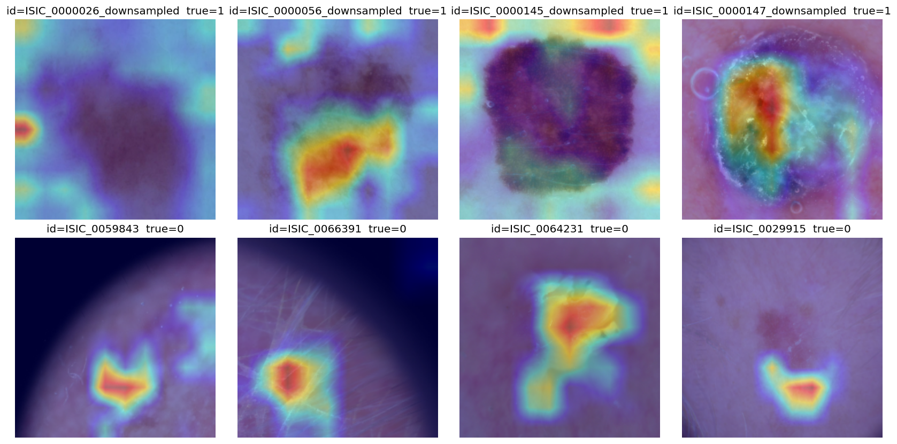

# Melanoma Detection under a Leakage-Audited Protocol

Binary melanoma detection on dermoscopy images. Ten methods, from logistic regression to
Swin-Tiny and a handcrafted–deep feature-fusion model, are compared on a single ISIC 2019
benchmark with exact-duplicate removal, lesion-grouped splits and augmentation applied to the
training split only.

**Paper:** *Lesion-Grouped and Leakage-Audited Melanoma Detection: Deep Architectures and
Clinical–Handcrafted–Deep Feature Fusion*, TOK 2026 (27th National Conference on Automatic
Control), Ankara University.
**Authors:** Feyza Toktaş, Zeynep Köymen, Adem Efe Devrez, Ezra Bolat — Department of Computer
Engineering, Ankara University.

## Benchmark

- **Corpus:** ISIC 2019 training set (25,331 images). HAM10000 is used only to audit provenance
  and overlap; it is not added a second time.
- **Task:** melanoma vs. all other lesions.
- **Subset:** all melanoma images plus an equal number of non-melanoma images, with exact
  duplicates (by image ID and stored-image hash) removed before splitting:
  **9,028 images (4,514 / 4,514)**. This is a balanced subset of ISIC 2019, not the full corpus.
- **Split:** stratified and grouped by `lesion_id` (seed 42):
  **6,366 train / 1,353 validation / 1,309 test** (649 melanoma, 660 non-melanoma).
  No lesion appears in more than one split, and augmentation touches the training split only.
- **Preprocessing:** DullRazor hair removal, Otsu lesion crop, 224×224 RGB.

## Methods

1. Logistic regression on raw 64×64 pixels
2. HOG + HSV colour histogram + GLCM → PCA → RBF-SVM
3. AlexNet
4. VGG16-BN
5. ResNet50
6. EfficientNet-B3
7. DenseNet121
8. Swin-Tiny
9. Soft-vote ensemble of the six CNNs
10. Hybrid fusion: handcrafted + ABCD-inspired clinical descriptors + deep features of the six
    CNNs → PCA → SMOTE-Tomek (training data only) → XGBoost

Methods 3–8 are fully fine-tuned and share one recipe: focal loss with class-balanced weights,
weighted sampling, training-only augmentation, AdamW with warm-up and cosine decay, weight EMA,
8-way test-time augmentation and a decision threshold tuned on the validation set.

## Results

Test set: 1,309 images (649 melanoma / 660 non-melanoma). Best value per column in bold.

| Method | Accuracy | Precision | Recall | F1 | ROC-AUC |
|---|---|---|---|---|---|
| 1. Logistic regression | 0.5852 | 0.5960 | 0.5069 | 0.5479 | 0.6245 |
| 2. HOG + colour + GLCM, PCA, SVM | 0.6516 | 0.6606 | 0.6117 | 0.6352 | 0.7181 |
| 3. AlexNet | 0.7410 | 0.6914 | 0.8629 | 0.7676 | 0.8192 |
| 4. VGG16-BN | 0.7456 | 0.7158 | 0.8074 | 0.7589 | 0.8341 |
| 5. ResNet50 | 0.7349 | 0.7240 | 0.7519 | 0.7377 | 0.8253 |
| 6. EfficientNet-B3 | 0.7357 | 0.7067 | 0.7982 | 0.7496 | 0.8238 |
| 7. DenseNet121 | 0.7487 | 0.6946 | **0.8798** | **0.7763** | 0.8462 |
| 8. Swin-Tiny | **0.7754** | **0.7685** | 0.7827 | 0.7756 | **0.8652** |
| 9. Soft-vote ensemble | 0.7555 | 0.7301 | 0.8043 | 0.7654 | 0.8569 |
| 10. Hybrid fusion | 0.7540 | 0.7535 | 0.7488 | 0.7512 | 0.8451 |

- DenseNet121 has the best F1 and recall; Swin-Tiny has the best accuracy, precision and ROC-AUC.
- The soft-vote ensemble and the hybrid fusion model do not beat the best single architectures
  under this protocol.
- The scores are not comparable with figures reported under image-level splits or without
  de-duplication; this protocol removes those sources of inflation. All numbers come from a
  single split (seed 42).

[`results/`](results/) holds the per-method metrics (`*_metrics.json`), the test-set predictions
(`*_predictions.csv`), `comparison_table.csv` and `ablation_table.csv`. In
`comparison_table.csv`, `train_time_sec` is empty for the CNN runs that were restored from a saved
checkpoint, and the hybrid model's inference time covers the fusion classifier only (deep
features are cached).



## Reproducing the results

The notebooks target Google Colab with a GPU runtime (an A100 was used for the CNNs). Each one
clones this repository, mounts Google Drive and keeps its artifacts under `MyDrive/melanoma/`
(separate `*_clean_v2` folders for data, checkpoints and results). A Kaggle API token
(`kaggle.json`) is needed for the dataset downloads.

Run the notebooks in this order: **00 → 12 → 13 → 01–09 → 11 → 10**

| Notebook | Purpose |
|---|---|
| `00_data_setup` | HAM10000 arrays, used only for the provenance audit |
| `12_isic2019_prep` | ISIC 2019 download and preprocessing |
| `13_clean_dataset_v2` | HAM10000/ISIC overlap audit and the balanced, lesion-grouped dataset; inspect the audit before training |
| `01`, `02` | Methods 1–2 |
| `03_deep_learning_effnet` | EfficientNet-B0 baseline, used only in one ablation row |
| `04`–`09` | Methods 3–8 (one notebook per CNN) |
| `11_hybrid_fusion` | Method 10 (needs the CNN checkpoints) |
| `10_aggregation` | Method 9 (ensemble), comparison and ablation tables |

Without a GPU you can still run the unit tests of the dataset builder:
`pip install -r requirements.txt` and `python -m pytest tests`.

## Repository layout

```
notebooks/   00–13, one per step
src/         data loading, preprocessing, segmentation, ABCD and handcrafted features, models,
             training, evaluation, Grad-CAM, and the audited dataset builder (clean_dataset.py)
tests/       unit tests for the dataset builder
results/     metrics, test-set predictions and tables of the reported run
config.py    paths and hyperparameters
```

## Data and references

Images are not redistributed. The notebooks download ISIC 2019 (Kaggle `andrewmvd/isic-2019` and
the official ISIC 2019 metadata) and HAM10000 (Kaggle `kmader/skin-cancer-mnist-ham10000`); check
each dataset's terms of use before reuse.

- ISIC 2019 Challenge, training data: <https://challenge.isic-archive.com/data/>
- P. Tschandl, C. Rosendahl, H. Kittler, "The HAM10000 dataset, a large collection of multi-source
  dermatoscopic images of common pigmented skin lesions," *Scientific Data* 5, 180161, 2018.
- M. Combalia et al., "BCN20000: Dermoscopic lesions in the wild," arXiv:1908.02288, 2019.
- B. Cassidy et al., "Analysis of the ISIC image datasets: usage, benchmarks and
  recommendations," *Medical Image Analysis* 75, 102305, 2022.
